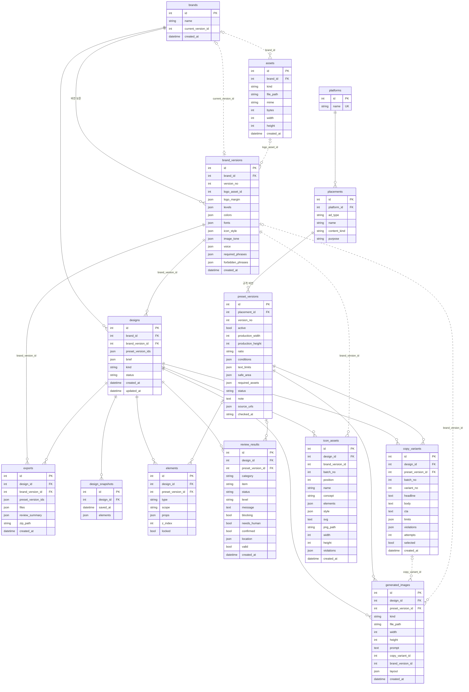

# ERD

`backend/app/models.py` 기준. 실선은 ForeignKey 제약, 점선은 FK 제약 없이 정수 컬럼으로만 참조하는 관계.

## 참고
- `designs.preset_version_ids`, `exports.preset_version_ids`는 JSON 배열이라 `preset_versions`와 N:M 관계지만 연결 테이블이 없다.
- `brands.current_version_id`, `brand_versions.logo_asset_id`, `generated_images.copy_variant_id`/`brand_version_id`, `icon_assets.brand_version_id`는 FK 제약이 없는 정수 컬럼이다.
